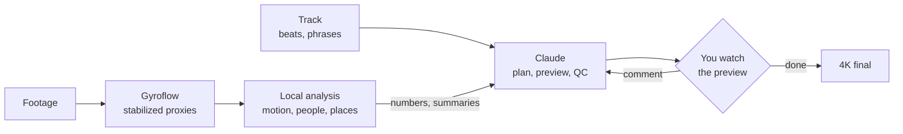

**English** | [Русский](README.ru.md)

# montAIge

Edits drone and action-camera footage to music. Claude (in Claude Code) makes the editing decisions. To be
honest, ChatGPT would cope too, but Claude wrote all this, so there you have it, ladies and gentlemen. Scripts
on your GPU analyse the footage and give the model numbers and short text summaries instead of frames.

<table>
  <tr>
    <td></td>
    <td></td>
  </tr>
  <tr>
    <td align="center"><i>Crinoline Dreams</i>, 54 s, 5 GoPro clips</td>
    <td align="center"><i>Carefree</i>, 45 s, 5 GoPro clips</td>
  </tr>
</table>

*Crinoline Dreams* ([how it was made](docs/examples/march.md)):

https://github.com/user-attachments/assets/b2d6810e-0868-49cd-830f-739d8cb230b3

*Carefree* ([how it was made](docs/examples/koprino.md)):

https://github.com/user-attachments/assets/32009a75-980b-4666-831b-a5e763c014bf

## What it does

- Music: beat grid, bars, phrases and loudness of the track. The track is shortened by whole phrases to the
  requested length; cuts fall on beats.
- Footage analysis, on your machine:
  - camera motion from the gyro track, if the camera records one (DJI, GoPro): turns, dives, climbs, flips,
    close passes, a piloting score;
  - people: who is in view, which of them is the pilot (FPV goggles or a radio), flying between someone's legs
    or over them, a main character described in words or shown by an example image;
  - places and activities by text query (CLIP), routes through several places, grouping clips by location;
  - earlier exports in the footage folder, matched to the original clips.
- Editing: shot choice, pacing, how much of the pilot to show, the track, two or three variants. You comment
  on 640 px previews, and the next preview follows the comments.
- QC: an OK / WARN report for each edit (length, rhythm, people, piloting, repeated activities, dark or
  frozen frames).
- Stabilization with [Gyroflow](https://gyroflow.xyz); finals in 4K.

## Tokens and time

The detectors (YOLO, CLIP) run locally; the model reads their numbers, not frames. Measured from the Claude
Code session logs of the two example clips, from the task to the edit the owner accepted:

| | Crinoline Dreams | Carefree |
|---|---|---|
| footage | 5 clips, ~16 min | 5 clips, ~20 min |
| time from the task to the accepted edit | 3 h 37 min ¹ | 1 h 08 min |
| requests to the model | 86 | 64 |
| tokens read, full-price equivalent ² | 2.1 M | 1.0 M |
| tokens written | 107 k | 103 k |
| images the model looked at | 3 | 10 |

¹ The people detector was written during this job.
² Re-reading cached context counts 0.1 of a full-price token, writing it 1.25.

| step (15 min of 4K footage, RTX 3050) | time |
|---|---|
| stabilize and analyse, once per footage | ~40 min (Gyroflow ~25, detectors ~15) |
| a new preview after a comment | 1-3 min |
| a one-minute 4K final | ~23 min |

### Why not show the model the footage

- The context is not elastic. An hour of footage at one frame per second is 3600 frames, ~1.1 M tokens; it
  does not fit, so the model would work on pieces and retellings of them.
- Every new question is another pass over all the footage. What the model has seen does not become data it
  can search again: where the pilot is, the staircase, the climbs, which clips are one place, this child.
- One frame per second is too coarse anyway: a pass close to a person lasts a fraction of a second, and moves
  are matched to beats from motion at 25-50 Hz. Faces need the 4K frames: at 640 px the eyes are 3 px apart.

Here the heavy part runs once and is kept, and a new question is a query over it:

| question | time |
|---|---|
| a place or a route in words ("a corridor → a staircase → a tennis court") | seconds, over frame embeddings computed once (1.5 min for 30 min of footage) |
| climbs and descents | seconds, from the same embeddings and the image motion |
| which clips were shot at one place | seconds |
| what happens in the footage, seconds per activity | seconds |
| a person by an example photo | 1-2 min, over the stored person crops |
| a face (two children in the same T-shirt) | one pass over the 4K originals, then any face is sorted at once |

## How it works



Methods and measurements: [docs/notes.md](docs/notes.md). Every job so far, with the owner's comments:
[docs/examples/](docs/examples/). How Claude works in this folder: [CLAUDE.md](CLAUDE.md).

## Quick start

Open Claude Code in this folder, describe the footage and what you want; Claude runs the steps below, shows
previews and asks what to change. The steps can also be run by hand.

```bash
export GYROFLOW="/path/to/Gyroflow.exe"     # Gyroflow 1.6.3
PY=/path/to/python                            # PyTorch with CUDA
$PY scripts/montage.py out/<job>/job.toml     # stabilize, analyse, edit, QC
$PY scripts/montage.py out/<job>/job.toml --final <edit> --size 3840x2880
```

A job file:

```toml
footage = ["/path/to/footage"]
args = ["--people", "4"]                      # options for every edit of the job

[[edit]]
name = "summer"
music = "models/music/Still_Pickin.mp3"
bpm = 100
target = 60                                   # seconds
args = ["--want", "ascent", "--theme", "a man working on a roof"]
```

Requirements: an NVIDIA GPU (tested on an RTX 3050, 8 GB), Python 3.11+, PyTorch with CUDA, ultralytics,
transformers, PyAV, OpenCV, NumPy, SciPy, Pillow, Matplotlib, Gyroflow 1.6.3; onnxruntime-gpu for face
matching only. Tested on Windows 10 with DJI O4 Pro, O4 Air Unit, O3 Air Unit, Avata 2 and GoPro footage.

Models, LUTs and music are not in the repository: Claude downloads what a job needs into `models/` next to
`scripts/`: YOLOv8s and YOLOv8s-pose (Ultralytics), CLIP ViT-B/32 (Hugging Face), SFace (OpenCV Model Zoo,
face matching only), DJI's D-Log M to Rec.709 LUT (log footage only; every DJI D-Log M LUT is the same
file), tracks from [incompetech.com](https://incompetech.com).

## Scripts

| script | |
|---|---|
| `montage.py` | runs a job file step by step; finished steps are skipped |
| `edit.py` | the edit: music analysis, shot choice, speed ramps, preview |
| `people.py` | poses, the pilot, close passes, a main character in words or by example |
| `places.py` | places and activities by text, routes, locations |
| `exports.py` | earlier exports matched to the originals |
| `qc.py` | the OK / WARN report |
| `final.py` | the 4K final from Gyroflow renders of the used pieces |
| `music_check.py` | checks a track: constant tempo, phrases |
| `dji_join.py` | joins split DJI recordings |

## Not implemented yet

- Footage without motion data: such clips are skipped for now; they could be edited from detection alone.
- Tracks without a constant tempo.

## Credits

- Music in the examples: "Crinoline Dreams" and "Carefree" by Kevin MacLeod
  ([incompetech.com](https://incompetech.com)), CC BY 4.0.
- [Gyroflow](https://gyroflow.xyz) (GPL-3.0), run as an external program.
- [Ultralytics YOLOv8](https://github.com/ultralytics/ultralytics) (AGPL-3.0),
  [CLIP](https://github.com/openai/CLIP) (MIT), SFace from the [OpenCV Model Zoo](https://github.com/opencv/opencv_zoo)
  (Apache-2.0).
- See also [PostFlight](https://github.com/Okhr/postflight): DJI FPV footage from the SD card to stabilized,
  graded clips.

## License

[AGPL-3.0](LICENSE)
