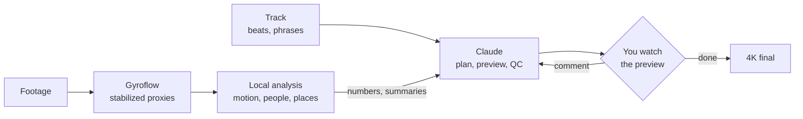

**English** | [Русский](README.ru.md)

# montAIge

**Filmed everything. Watched nothing. Fixed.**

> *"I liked it, and people with worse taste are absolutely delighted."*
> — Zinovy Gerdt

Everyone films: the drone, the GoPro on the helmet, the phone. Nobody watches: hours of footage go to a drive
and stay there, because going through them takes longer than the trip did. Here you point it at the folder, say
in a sentence what it was and who is in it, and get back a minute cut to music: the best moments, cuts where
the music asks for them, nothing you would skip. Fair warning: it can easily take all night, because even maths
needs time to do maths. Then anything can be fixed: just say in plain words what is wrong.

Edits any footage to music. Claude (in Claude Code) makes the editing decisions. To be
honest, ChatGPT would cope too, but Claude wrote all this, so there you have it, ladies and gentlemen. Scripts
on your GPU analyse the footage and give the model numbers and short text summaries instead of frames.

<table>
  <tr>
    <td></td>
    <td></td>
    <td></td>
  </tr>
  <tr>
    <td align="center"><i>Crinoline Dreams</i>, 54 s, 5 GoPro clips</td>
    <td align="center"><i>Carefree</i>, 45 s, 5 GoPro clips</td>
    <td align="center"><i>Living Voyage</i>, 1:31, 14 GoPro clips, 31 GB</td>
  </tr>
</table>

*Crinoline Dreams* ([how it was made](docs/examples/march.md)):

https://github.com/user-attachments/assets/b2d6810e-0868-49cd-830f-739d8cb230b3

*Carefree* ([how it was made](docs/examples/koprino.md)):

https://github.com/user-attachments/assets/32009a75-980b-4666-831b-a5e763c014bf

*Living Voyage*, a holiday in Dagestan; five of the clips had lost their gyro
([how it was made](docs/examples/dagestan.md)):

https://github.com/user-attachments/assets/298f87c8-04dd-475a-b33f-7d5b72b9fbe3

## What it does

- Music: beat grid, bars, phrases and loudness of the track. The track is shortened by whole phrases to the
  requested length; cuts fall on beats, and a strong hit in the music gets a cut or a manoeuvre.
- Footage analysis, on your machine:
  - camera motion from the gyro track, if the camera records one (DJI, GoPro, a `.gcsv` log), or from the
    picture when there is no gyro to read (a clip stabilized elsewhere, a camera without one): turns, dives,
    climbs, flips, close passes, a piloting score;
  - people: who is in view, which of them is the pilot (FPV goggles or a radio), flying between someone's legs
    or over them, a main character described in words or shown by an example image;
  - places and activities by text query (CLIP), routes through several places, grouping clips by location;
  - earlier exports in the footage folder, matched to the original clips;
  - beautiful views, on request, with beauty in the job's own words (mountains, a beach);
  - the footage in words: a local vision-language model describes every three seconds ("a man is jumping into
    the water from a boat"), so a moment is found by its words, and looks over every shot of an edit before you
    see it;
  - speech, on request: what people say (Whisper) and who says it (voices told apart across all the clips,
    pyannote), sung or spoken; a voice is nearly a person in view, except the one holding the camera.
- Editing: shot choice, pacing (a build of shorter shots before a drop, a long one on it), shot sizes that
  alternate, an establishing first shot and a closing last one, how much of the pilot to show, the track, the
  footage's own sound under the music at a laugh or a splash, a line someone says heard whole with the music
  ducked under it, dissolves on calm music, a moment in slow motion,
  two or three variants. You comment on 640 px previews, and the next preview follows the comments.
- QC: an OK / WARN report for each edit (length, rhythm, people, piloting, repeated activities, dark or
  frozen frames).
- Stabilization with [Gyroflow](https://gyroflow.xyz); finals in 4K.

## Tokens and time

The detectors (YOLO, CLIP) run locally; the model reads their numbers, not frames. Measured from the Claude
Code session logs of the example clips, from the task to the edit the owner accepted:

| | Crinoline Dreams | Carefree | Living Voyage |
|---|---|---|---|
| footage | 5 clips, ~16 min | 5 clips, ~20 min | 14 clips, ~47 min, 31 GB |
| time from the task to the accepted edit | 3 h 37 min ¹ | 1 h 08 min | ~1 h 30 min ³ |
| requests to the model | 86 | 64 | ~120 ³ |
| tokens read, full-price equivalent ² | 2.1 M | 1.0 M | ~2 M ³ |
| tokens written | 107 k | 103 k | ~80 k ³ |
| images the model looked at | 3 | 10 | 17 ³ |

¹ The people detector was written during this job.
² Re-reading cached context counts 0.1 of a full-price token, writing it 1.25.
³ The job alone, estimated: the session (2 h 41 min, 242 requests, 7.7 M read, 261 k written, 21 images) also
wrote motion from the picture, beautiful views and changing a finished edit, and waited ~70 min for the footage
to copy off a slow USB drive. Its requests split by what they did: 119 for the job, 3.6 M read, in a context
about twice as long as the job alone would have had.

| step (15 min of 4K footage, RTX 3050) | time |
|---|---|
| stabilize and analyse, once per footage | ~30 min (Gyroflow ~25, detectors ~5) |
| a new preview after a comment | ~1 min |
| a one-minute 4K final | ~23 min |

### Why not show the model the footage

- The context is not elastic. An hour of footage at one frame per second is 3600 frames, ~1.1 M tokens; it
  does not fit, so the model would work on pieces and retellings of them.
- Every new question is another pass over all the footage. What the model has seen does not become data it
  can search again: where the pilot is, the staircase, the climbs, which clips are one place, this child.
- One frame per second is too coarse anyway: a pass close to a person lasts a fraction of a second, and moves
  are matched to beats from motion at 25-50 Hz. Faces need the 4K frames: at 640 px the eyes are 3 px apart.

Here the heavy part runs once and is kept, and a new question is a query over it:

| question | time |
|---|---|
| a place or a route in words ("a corridor → a staircase → a tennis court") | seconds, over frame embeddings computed once (1.5 min for 30 min of footage) |
| climbs and descents | seconds, from the same embeddings and the image motion |
| which clips were shot at one place | seconds |
| what happens in the footage, seconds per activity | seconds |
| a person by an example photo | 1-2 min, over the stored person crops |
| a face (two children in the same T-shirt) | one pass over the 4K originals, then any face is sorted at once |

## How it works



Methods and measurements: [docs/notes.md](docs/notes.md). Every job so far, with the owner's comments:
[docs/examples/](docs/examples/). How Claude works in this folder: [CLAUDE.md](CLAUDE.md).

## Quick start

Open Claude Code in this folder, describe the footage and what you want; Claude runs the steps below, shows
previews and asks what to change. The steps can also be run by hand.

```bash
export GYROFLOW="/path/to/Gyroflow.exe"     # Gyroflow 1.6.3
PY=/path/to/python                            # PyTorch with CUDA
$PY scripts/montage.py out/<job>/job.toml     # stabilize, analyse, edit, QC
$PY scripts/montage.py out/<job>/job.toml --final <edit> --size 3840x2880
```

A job file:

```toml
footage = ["/path/to/footage"]
args = ["--people", "4"]                      # options for every edit of the job

[[edit]]
name = "summer"
music = "models/music/Still_Pickin.mp3"
bpm = 100
target = 60                                   # seconds
args = ["--want", "ascent", "--theme", "a man working on a roof"]
```

Requirements: an NVIDIA GPU (tested on an RTX 3050, 8 GB), Python 3.11+, PyTorch with CUDA, ultralytics,
transformers and accelerate, PyAV, OpenCV, NumPy, SciPy, Pillow, Matplotlib, Gyroflow 1.6.3; onnxruntime-gpu for face
matching only; speech (optional) in a second environment, `models/venvs/speech` (or `SPEECH_PY`): PyTorch with
CUDA, pyannote.audio 4 (it wants NumPy 2), transformers, PyAV. Tested on Windows 10 with DJI O4 Pro, O4 Air Unit, O3 Air Unit, Avata 2 and GoPro footage, and
with clips with no usable gyro (an Osmo Action 3, exports stabilized elsewhere): their camera motion comes from
the picture.

```bash
python -m venv models/venvs/speech              # speech only (job `speech = "ru"`); montage.py finds it there
models/venvs/speech/Scripts/python -m pip install torch torchaudio --index-url https://download.pytorch.org/whl/cu128
models/venvs/speech/Scripts/python -m pip install pyannote.audio transformers av soundfile scipy
```

Models, LUTs and music are not in the repository (but one): Claude downloads what a job needs into `models/` next to
`scripts/`: YOLOv8s and YOLOv8s-pose (Ultralytics), CLIP ViT-B/32 (Hugging Face), SFace (OpenCV Model Zoo,
face matching only), the LAION aesthetic predictor for CLIP ViT-B/32 (beautiful views only), DJI's D-Log M to
Rec.709 LUT (log footage only; every DJI D-Log M LUT is the same file), Whisper large-v3-turbo (speech only),
tracks from [incompetech.com](https://incompetech.com). pyannote's speaker-diarization-community-1 (speech only, 33 MB)
is in the repository in `models/diarization/`: on Hugging Face it stands behind a contact form; it is CC BY 4.0, not
AGPL like the rest, and its README there gives the credits.

## Scripts

| script | |
|---|---|
| `montage.py` | runs a job file step by step; finished steps are skipped |
| `edit.py` | the edit: music analysis, shot choice, speed ramps, preview |
| `people.py` | poses, the pilot, close passes, tracks, a main character in words or by example (a screenshot found in the footage) |
| `places.py` | places and activities by text, routes, locations |
| `exports.py` | earlier exports matched to the originals |
| `vis_motion.py` | camera motion from the picture, for clips with no gyro to read (stabilized elsewhere, a camera without one) |
| `camera.py` | flown or carried, per clip, from a GoPro's accelerometer |
| `gps.py` | where a GoPro clip was shot, and how fast and which way up or down, from its GPS |
| `timeline.py` | every feature in one SQLite table, a row per half second: questions across them in one query |
| `beauty.py` | how beautiful the view is: an aesthetic score and beautiful views in words |
| `captions.py` | the footage in words every 3 s (Qwen3-VL, local), searched by words |
| `review.py` | the model's line per shot of a finished edit: what it shows, what is wrong with it |
| `sounds.py` | the clips' own sound in words (CLAP): laughter, a shout, a splash; the sound bites of an edit |
| `speech.py` | what people say (Whisper) and who says it (pyannote: voices told apart across clips); the phrases an edit lets you hear |
| `proxy.py` | small proxies of clips stabilized elsewhere, frame for frame |
| `edl_edit.py` | changes a finished edit without planning it again: one scene replaced, a named moment put in a shot, the ending taking over, the colour of two cameras matched |
| `qc.py` | the OK / WARN report |
| `final.py` | the 4K final from Gyroflow renders of the used pieces |
| `lut_clips.py` | whole clips graded with a LUT on the GPU at their own size, 10-bit in and out: a delivery of stabilized clips without an edit |
| `music_check.py` | checks a track: constant tempo, phrases |
| `music_like.py` | catalogue tracks that sound like one the owner liked (CLAP) |
| `dji_join.py` | joins split DJI recordings |

## Not implemented yet

- Stabilization from the picture: a clip without motion data is edited as it is, its camera motion read from the
  picture (the scan takes it in under a `_stabilized` name, since a bare mp4 beside originals is usually an
  export of one, and warns about any it left out); smoothing the picture itself is not done, a shaky phone clip
  stays shaky.
- Tracks without a constant tempo.

## Credits

- Music in the examples: "Crinoline Dreams" and "Carefree" by Kevin MacLeod
  ([incompetech.com](https://incompetech.com)), CC BY 4.0.
- [Gyroflow](https://gyroflow.xyz) (GPL-3.0), run as an external program.
- [Ultralytics YOLOv8](https://github.com/ultralytics/ultralytics) (AGPL-3.0),
  [CLIP](https://github.com/openai/CLIP) (MIT), SFace from the [OpenCV Model Zoo](https://github.com/opencv/opencv_zoo)
  (Apache-2.0), the [LAION aesthetic predictor](https://github.com/LAION-AI/aesthetic-predictor) (MIT),
  [Whisper](https://github.com/openai/whisper) (MIT), [pyannote.audio](https://github.com/pyannote/pyannote-audio)
  (MIT) with its speaker-diarization-community-1 model (CC BY 4.0).
- See also [PostFlight](https://github.com/Okhr/postflight): DJI FPV footage from the SD card to stabilized,
  graded clips.

## License

[AGPL-3.0](LICENSE)
