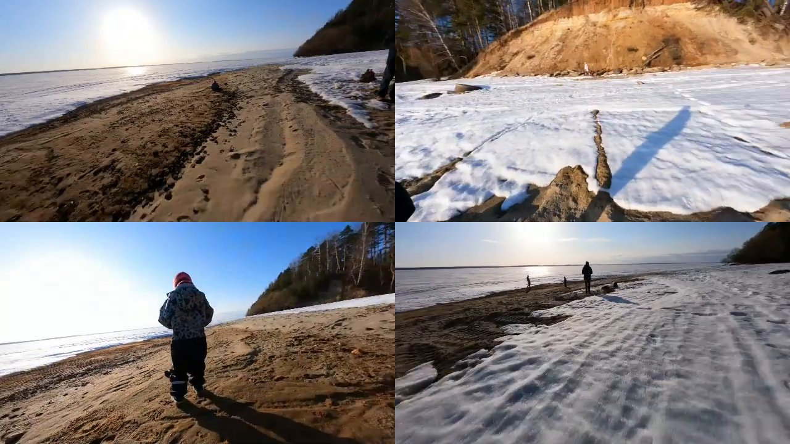
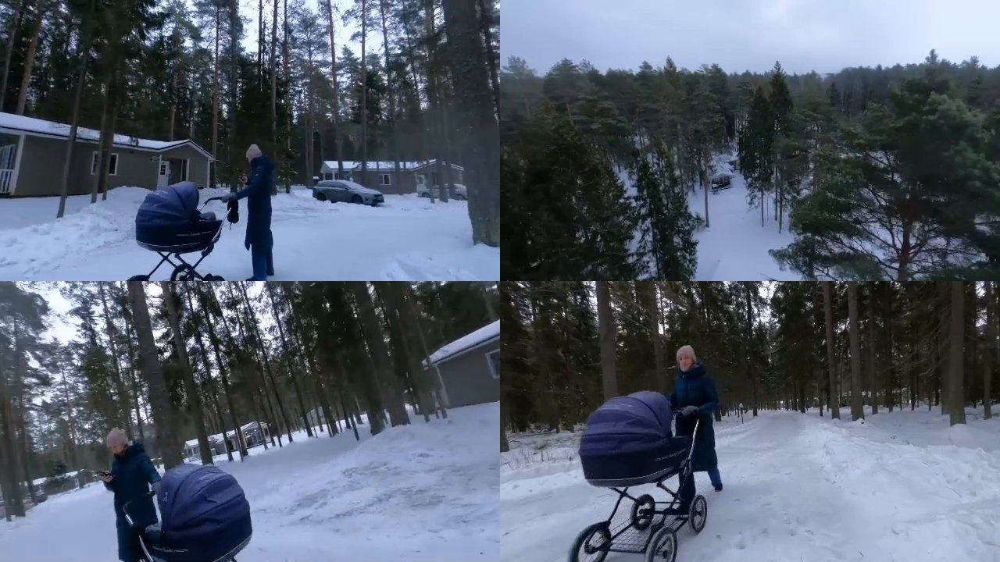
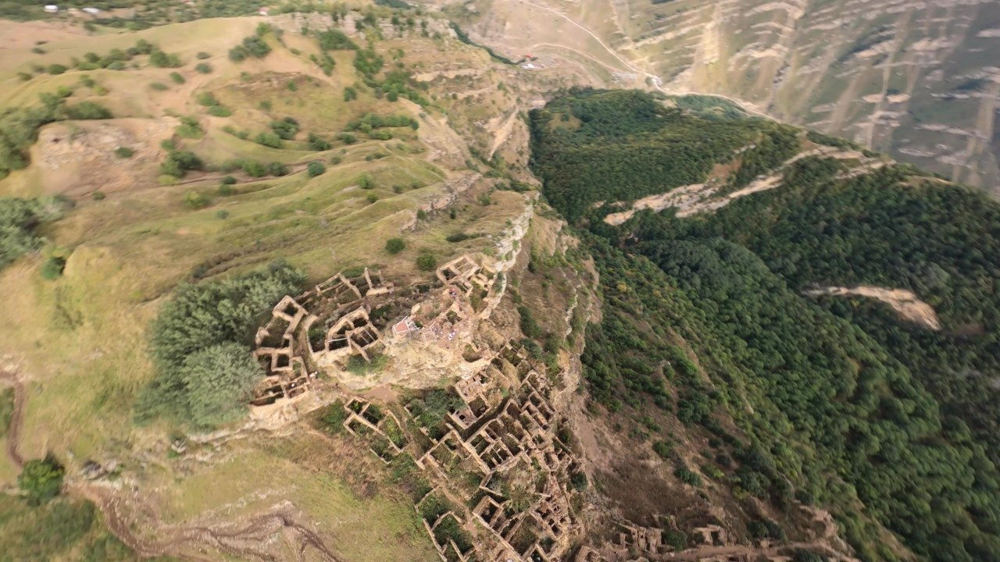
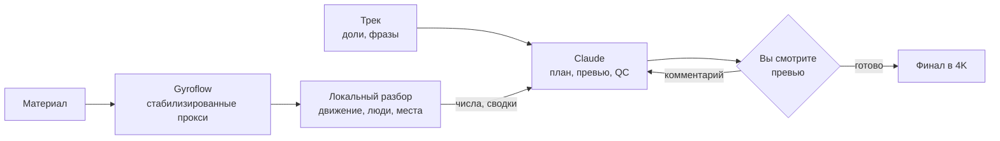

[English](README.md) | **Русский**

# montAIge

> *«Мне понравилось, а у кого вкус хуже, те вообще в восторге».*
> — Зиновий Гердт

Монтирует видео с дрона и экшн-камеры под музыку. Монтажные решения принимает Claude (в Claude Code). Если
честно, справился бы и ChatGPT, но всё это писал Claude, так что, господа, такие дела. Скрипты на вашей
видеокарте разбирают материал и передают модели числа и короткие текстовые сводки вместо кадров.

<table>
  <tr>
    <td></td>
    <td></td>
    <td></td>
  </tr>
  <tr>
    <td align="center"><i>Crinoline Dreams</i>, 54 с, 5 клипов GoPro</td>
    <td align="center"><i>Carefree</i>, 45 с, 5 клипов GoPro</td>
    <td align="center"><i>Living Voyage</i>, 1:31, 14 клипов GoPro, 31 ГБ</td>
  </tr>
</table>

*Crinoline Dreams* ([как сделан](docs/examples/march.md), на английском):

https://github.com/user-attachments/assets/b2d6810e-0868-49cd-830f-739d8cb230b3

*Carefree* ([как сделан](docs/examples/koprino.md), на английском):

https://github.com/user-attachments/assets/32009a75-980b-4666-831b-a5e763c014bf

*Living Voyage*, отпуск в Дагестане; у пяти клипов не осталось гироданных
([как сделан](docs/examples/dagestan.md), на английском):

https://github.com/user-attachments/assets/298f87c8-04dd-475a-b33f-7d5b72b9fbe3

## Что делает

- Музыка: сетка долей, такты, фразы и громкость трека. Трек сокращается целыми фразами до нужной длины,
  склейки попадают на доли.
- Разбор материала, на вашем компьютере:
  - движение камеры по гироскопу, если камера его пишет (DJI, GoPro), или по картинке клипа, стабилизированного
    в другом месте без гироданных: повороты, пике, подъёмы, флипы, пролёты вплотную, оценка пилотирования;
  - люди: кто в кадре, кто из них пилот (FPV-очки или пульт), пролёт между ног или над человеком, главный
    герой по описанию словами или по фото-примеру;
  - места и действия по текстовому запросу (CLIP), маршруты через несколько мест, группировка клипов по
    локациям;
  - старые экспорты в папке с материалом, сопоставленные с оригиналами;
  - красивые виды, по запросу, а что красиво, задание говорит своими словами (горы, пляж).
- Монтаж: выбор кадров, темп, сколько показывать пилота, трек, два-три варианта. Вы комментируете превью
  640 px, следующее превью учитывает комментарии.
- QC: отчёт OK / WARN по каждому ролику (длина, ритм, люди, пилотирование, повторы одного действия, тёмные
  и застывшие кадры).
- Стабилизация [Gyroflow](https://gyroflow.xyz); финал в 4K.

## Токены и время

Детекторы (YOLO, CLIP) работают локально; модель читает их числа, а не кадры. Замерено по журналам сессий
Claude Code для роликов из примеров, от задания до ролика, который владелец принял:

| | Crinoline Dreams | Carefree | Living Voyage |
|---|---|---|---|
| материал | 5 клипов, ~16 мин | 5 клипов, ~20 мин | 14 клипов, ~47 мин, 31 ГБ |
| время от задания до принятого ролика | 3 ч 37 мин ¹ | 1 ч 08 мин | ~1 ч 30 мин ³ |
| запросов к модели | 86 | 64 | ~120 ³ |
| прочитано токенов, в пересчёте на полную цену ² | 2.1 млн | 1.0 млн | ~2 млн ³ |
| написано токенов | 107 тыс. | 103 тыс. | ~80 тыс. ³ |
| картинок, которые видела модель | 3 | 10 | 17 ³ |

¹ Детектор людей писался по ходу этого задания.
² Повторное чтение закэшированного контекста идёт за 0.1 полной цены токена, запись — за 1.25.
³ Только само задание, оценка: за сессию (2 ч 41 мин, 242 запроса, 7.7 млн прочитано, 261 тыс. написано,
21 картинка) ещё написаны движение по картинке, красивые виды и правка готового монтажа, и ~70 мин материал
копировался с медленного USB-диска. Запросы разделены по тому, что они делали: 119 на задание, 3.6 млн
прочитано, в контексте примерно вдвое длиннее, чем был бы у одного задания.

| шаг (15 мин материала 4K, RTX 3050) | время |
|---|---|
| стабилизация и разбор, один раз на материал | ~40 мин (Gyroflow ~25, детекторы ~15) |
| новое превью после комментария | 1-3 мин |
| минутный финал в 4K | ~23 мин |

### Почему не показать модели сам материал

- Контекст не резиновый. Час материала при кадре в секунду — это 3600 кадров, ~1.1 млн токенов; это не
  влезает, и модель работала бы с кусками и их пересказами.
- Каждый новый вопрос — новый проход по всему материалу. То, что модель посмотрела, не становится данными,
  по которым можно искать снова: где пилот, где лестница, где подъёмы, какие клипы сняты в одном месте, где
  вот этот ребёнок.
- Кадра в секунду всё равно мало: пролёт рядом с человеком длится доли секунды, а движения подгоняются к долям
  по данным с частотой 25-50 Гц. Для лиц нужны 4K-кадры: в 640 px глаза в 3 пикселях друг от друга.

Здесь тяжёлая часть делается один раз и сохраняется, а новый вопрос — это запрос к ней:

| вопрос | время |
|---|---|
| место или маршрут словами («коридор → лестница → теннисный корт») | секунды, по эмбеддингам кадров, посчитанным один раз (1.5 мин на 30 мин материала) |
| подъёмы и горки | секунды, по тем же эмбеддингам и движению в кадре |
| какие клипы сняты в одном месте | секунды |
| что происходит в материале, секунды на каждое действие | секунды |
| человек по фото-примеру | 1-2 мин, по сохранённым кропам людей |
| лицо (двое детей в одинаковых футболках) | один проход по 4K-оригиналам, потом любое лицо сортируется сразу |

## Как это устроено



Методы и замеры: [docs/notes.md](docs/notes.md). Все задания с комментариями владельца материала:
[docs/examples/](docs/examples/). Как Claude работает в этой папке: [CLAUDE.md](CLAUDE.md). Эти документы на
английском.

## Быстрый старт

Откройте Claude Code в этой папке, опишите материал и что нужно получить; Claude запустит шаги ниже, покажет
превью и спросит, что поменять. Шаги можно запускать и вручную.

```bash
export GYROFLOW="/path/to/Gyroflow.exe"     # Gyroflow 1.6.3
PY=/path/to/python                            # PyTorch с CUDA
$PY scripts/montage.py out/<job>/job.toml     # стабилизация, разбор, монтаж, QC
$PY scripts/montage.py out/<job>/job.toml --final <edit> --size 3840x2880
```

Файл задания:

```toml
footage = ["/path/to/footage"]
args = ["--people", "4"]                      # опции для всех роликов задания

[[edit]]
name = "summer"
music = "models/music/Still_Pickin.mp3"
bpm = 100
target = 60                                   # секунды
args = ["--want", "ascent", "--theme", "a man working on a roof"]
```

Требования: видеокарта NVIDIA (проверено на RTX 3050, 8 ГБ), Python 3.11+, PyTorch с CUDA, ultralytics,
transformers, PyAV, OpenCV, NumPy, SciPy, Pillow, Matplotlib, Gyroflow 1.6.3; onnxruntime-gpu нужен только
для сравнения лиц. Проверено на Windows 10 с материалом DJI O4 Pro, O4 Air Unit, O3 Air Unit, Avata 2 и GoPro.

Модели, LUT и музыки в репозитории нет: всё, что нужно заданию, Claude скачивает в `models/` рядом со
`scripts/`: YOLOv8s и YOLOv8s-pose (Ultralytics), CLIP ViT-B/32 (Hugging Face), SFace (OpenCV Model Zoo, только
для сравнения лиц), эстетический предиктор LAION для CLIP ViT-B/32 (только для красивых видов), LUT DJI из
D-Log M в Rec.709 (только для log-материала; у всех камер DJI это один и тот же файл), треки с
[incompetech.com](https://incompetech.com).

## Скрипты

| скрипт | |
|---|---|
| `montage.py` | выполняет файл задания по шагам; готовые шаги пропускаются |
| `edit.py` | монтаж: разбор музыки, выбор кадров, рампы скорости, превью |
| `people.py` | позы, пилот, пролёты вплотную, главный герой словами или по примеру |
| `places.py` | места и действия по тексту, маршруты, локации |
| `exports.py` | старые экспорты, сопоставленные с оригиналами |
| `vis_motion.py` | движение камеры по картинке, для клипов, стабилизированных в другом месте |
| `beauty.py` | насколько красив вид: эстетическая оценка и красивые виды словами |
| `proxy.py` | маленькие прокси клипов, стабилизированных в другом месте, кадр в кадр |
| `edl_edit.py` | правка готового монтажа без пересборки: замена сцены, финал на месте убранных сцен |
| `qc.py` | отчёт OK / WARN |
| `final.py` | финал в 4K из рендеров Gyroflow только нужных кусков |
| `music_check.py` | проверка трека: ровный темп, фразы |
| `dji_join.py` | склейка разрезанных записей DJI |

## Пока не сделано

- Материал без данных о движении, который никогда не стабилизировали (телефон, запись очков): пока пропускается.
- Треки без ровного темпа.

## Благодарности

- Музыка в примерах: «Crinoline Dreams» и «Carefree», Kevin MacLeod
  ([incompetech.com](https://incompetech.com)), CC BY 4.0.
- [Gyroflow](https://gyroflow.xyz) (GPL-3.0), запускается как внешняя программа.
- [Ultralytics YOLOv8](https://github.com/ultralytics/ultralytics) (AGPL-3.0),
  [CLIP](https://github.com/openai/CLIP) (MIT), SFace из [OpenCV Model Zoo](https://github.com/opencv/opencv_zoo)
  (Apache-2.0), [эстетический предиктор LAION](https://github.com/LAION-AI/aesthetic-predictor) (MIT).
- См. также [PostFlight](https://github.com/Okhr/postflight): FPV-материал DJI от SD-карты до стабилизированных
  и отгрейженных клипов.

## Лицензия

[AGPL-3.0](LICENSE)
